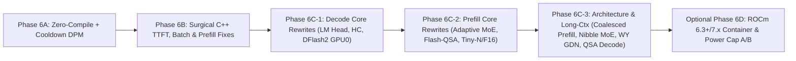

# Dual-MI50 (`gfx906`) Full-Stack Optimization Plan — Decode, Prefill, TTFT & Power Management

> **Engineering & Verification Policy:** Every engine change is **opt-in** via environment variables so the default path stays byte-identical. Verification uses **fast targeted runs** (kernel micro-benchmarks, bitwise/KL parity tests, and single-pass `~30–60 s` live checks against the running server). Previous binaries and config backups stay intact for instant rollback. All speed projections below are **unconfirmed static analysis** until measured per phase.

---

## 1. Current Measured Baseline (Post-Phase 5, Dedicated Dual MI50 @ `180 W`)

| Metric | Measured Baseline (`split=25`, 100% VRAM resident, `no loan`) | Full-Plan Projected Ceiling *(static analysis, `180 W`)* |
|---|---:|---:|
| **Solo Decode — Prose** (`256` tok, `temp=0`, thinking off) | `61.2 tok/s` pure (`53.9` e2e) | **`~90–105 tok/s`** (`+50–70%`) |
| **Solo Decode — Code** (`256` tok, `temp=0`, thinking off) | `81.0 tok/s` pure (`72.7` e2e) | **`~125–145 tok/s`** (`+55–80%`) |
| **4× Batch Decode — Code** (total aggregate) | `~135 tok/s` (`~34/slot`) | **`~230–280 tok/s`** (`~58–70/slot`, `+70–105%`) |
| **Prefill — Short** (`300–500` fresh tok) | `245–360 tok/s` (`1.24–1.41 s`) | **`~800–1,150 tok/s`** (`~0.35–0.50 s`, **`~3×`**) |
| **Prefill — Medium** (`2k–3.4k` fresh tok) | `500–687 tok/s` (`2k` = `2.6–3.0 s`) | **`~1,350–1,650 tok/s`** (**`~2.4×`**) |
| **Prefill — Long** (`10k–29k` fresh tok) | `937–995 tok/s` *(pre-`READ_PIECE`)* | **`~1,500–1,800 tok/s`** (**`~1.6–1.8×`**) |
| **TTFT — 40-tok Cold Prompt** | `354–547 ms` | **`~140–190 ms`** (**`-60%`**) |
| **TTFT — 303-tok Cached Follow-up** (`max_tokens=1`, `logprobs`) | `1,238 ms` | **`~320–420 ms`** (**`-70%`**) |
| **TTFT — 4× Concurrent 300-tok Burst** | `~2,800–3,500 ms` serial | **`~750–950 ms`** (**`~3–3.5×`**) |
| **Hot Conversation Switch** (`4K–16K` tok) | `~146 ms` (host RAM park + restore) | **`~2–4 ms`** (VRAM D2D) |
| **Idle Power** (`auto` / `high` measured live) | `19–20 W` / card (`~39 W` pair) | **`~39 W` idle** (after cooldown) · **`+8 W`** only while active |
| **Free VRAM Available** (loaded, `split=25`, `no loan`) | `3,907 MiB` GPU 0 · `1,906 MiB` GPU 1 | Budgeted cleanly across phases (see Section 4) |

---

## 2. Execution Architecture Overview

---

## 3. Detailed Phased Work Plan

### Phase 6A — Zero-Compile Config Wins + Demand-Driven DPM Cooldown *(~30 min, 0 C++ compile)*

All items below use code already compiled into the current `gfx906` binary plus a lightweight non-intrusive DPM cooldown controller.

1. **Demand-Driven DPM Hold (`auto` ↔ `high` with Cooldown) — Best Home Power Trade-Off:**
   - **Behavior:** Keep `power1_cap` at **`180 W`** (Vega 20's perf/watt sweet spot; `60–61°C` junc). When Strata has any request in flight (`GET /v1/status` → `activity.in_flight > 0`), switch both MI50s to `high` (`mclk` pinned at `1000 MHz`, preventing `350 MHz` HBM2 dips between GPU 0 ↔ GPU 1 handoffs and rapid follow-up turns; costs only `+4 W/card` while held). After **`120 s`** (configurable) of `in_flight == 0`, automatically restore `auto` (`19–20 W/card`, **`~39 W` total idle** overnight).
   - **Implementation:** Grant service write access only to the two `power_dpm_force_performance_level` sysfs nodes in the GPU preflight script, and run a lightweight ~35-line systemd watcher polling local `127.0.0.1:11434/v1/status` (or wire an opt-in hook in `server.py`) with `auto` restored cleanly on service stop.
2. **Restore Idle 2-GPU Prefill Overlap (`STRATA_PIPED_READ_PIECE`: `2048 → 16384`):**
   - Fixes the Phase-5 idle drain bug in [batch_read.hpp](../engine/include/strata/program/batch_read.hpp#L90-L95) while keeping `STRATA_PIPED_FAIR=1` + `STRATA_PIPED_DECODE_CHUNK=1024` for active decoding slots. **Est. `+25–45%` on idle `3k–30k` prefills immediately.**
3. **Enable Compiled-In Prefill & Caching Wins in Production Config:**
   - `STRATA_PF_W16_CACHE_MIB=2400` + `STRATA_DEQUANT_WIDE=1` ([gemm.cu](../engine/src/prefill/gemm.cu#L1431-L1489) — caches ~2.3 GiB of GPU 0 dense weights, leaving ~1.5 GiB for elastic vision).
   - `STRATA_GDN_CONVL2=2` ([kernels.cu](../engine/src/prefill/kernels.cu#L413-L464) — register-only `float4` pass).
   - `STRATA_PLE_COMPACT=1` + `STRATA_PLE_COPY_STREAM=1` ([prefill.cpp](../engine/src/prefill/prefill.cpp#L4475-L4501) — `7.1×` smaller async IQ4_NL PLE upload).
   - `STRATA_SLOT_CKPT_KV_DIRECT=1` + `STRATA_SLOT_CKPT_MOVE=1` ([generate.cpp](../engine/src/program/generate.cpp#L16430), [L19390](../engine/src/program/generate.cpp#L19390) — `-40 to -100 ms` on cached slot-checkpoint resume).
   - Remove dead/no-op flags from profile (`STRATA_PF_FUSED`, `STRATA_FUSE_HITS`, `STRATA_HIP_ROUTER_WAVE_FAST`, `STRATA_FUSE_DECODE`) and test dropping `STRATA_DF2_HEAD=indexed` (uses `213 MiB` of GPU 1's `1.9 GiB` free VRAM for faster contiguous draft head).
   - Quick single-pass verification of previously un-isolated decode flags: `STRATA_VERIFY_QDEDUP=1`, `STRATA_QFUSE=1`, `STRATA_BATCH_GDN_GROUPS=1`, `STRATA_BATCH_ATTN_ROWS=1`, `STRATA_DF_PLE=1`, `STRATA_ONE_TOKEN_COMMIT=1`, `STRATA_FUSE_CONVAB=1`, and `STRATA_TOPK_REG_MIN_BLOCKS=22528` (keep only those verified faster/clean).
4. **Verification Gate (6A):** Single ~45 s live pass measuring: idle watts (`auto` vs `high` cooldown), `40`-tok TTFT, `303`-tok cached follow-up, `3.4k`/`9k` cold prefill, solo prose/code, and 4× batch code. Document & commit/push.

---

### Phase 6B — High-ROI Surgical C++/HIP Engine Pack *(Biggest Latency & Batch Wins per LOC)*

Every change is localized, low-risk, and independently switchable.

| ID | Change & Target Files | Opt-In Flag / Scope | Expected Gain |
|---|---|---|---|
| **6B.1** | **Unlock `STRATA_SLOT_READ` (`_WIDE`, `_AHEAD`) for `STRATA_BATCH_DF2=1`** [generate.cpp](../engine/src/program/generate.cpp#L15654), [L18997-L19005](../engine/src/program/generate.cpp#L18997-L19005) | Existing `STRATA_SLOT_READ=1` (~20 LOC) | `-50 to -150 ms` copy + **0 ms stall** to other slots on cached follow-ups (`<=256–512` tok) |
| **6B.2** | **Enable `read_windows_pl` (2-GPU Overlapped Short Prompt Windows) with DFlash2** [generate.cpp](../engine/src/program/generate.cpp#L19821-L19931) | `STRATA_WIN_PL_DF2=1` (~50 LOC) | **`-150 to -200 ms` (`-45%` TTFT)** on all `<=64`-tok prompts (`40` tok: `354–547 → ~160–210 ms`) |
| **6B.3** | **Skip DFlash2 Rebuild/Taps on `max_tokens=1` + Batched 1-Sync `df2.context()` + Pinned `dland.bounce`** [generate.cpp](../engine/src/program/generate.cpp#L13051), [L19675-L19689](../engine/src/program/generate.cpp#L19675-L19689), [L22927-L22930](../engine/src/program/generate.cpp#L22927-L22930), [dflash2.cpp](../engine/src/core/dflash2.cpp#L1005-L1023), [server.py](../terminal/serve/server.py#L1970) | `STRATA_DF2_FAST_CTX=1`, `STRATA_DF2_SKIP_MAX1=1` (~100 LOC) | **`-70 to -120 ms`** on 303-tok `max_tokens=1`; **`-80 to -150 ms`** on every 2k prefill; eliminates 256× serial GPU syncs |
| **6B.4** | **Fix `STRATA_ADMIT_MERGE_FIRST=1` for `pipe && batch_df2` + Solo `GEN`** [generate.cpp](../engine/src/program/generate.cpp#L21088-L21103), [L21474](../engine/src/program/generate.cpp#L21474) | Existing `STRATA_ADMIT_MERGE_FIRST=1` (~50 LOC) | **`-35 to -50 ms`** on **every** chat turn (eliminates extra `T=3..4` header window) |
| **6B.5** | **Unblock `STRATA_PF_I8_GPU_PLAN` for `T < 820` + Static `[48][512]` Device Ptr Table + Idle `piped_fair_piece=0` + `W16` Per-GPU Reserve & BF16 Cache + `DEQUANT_SIDE` on HIP** [prefill.cpp](../engine/src/prefill/prefill.cpp#L3574-L3634), [L5686-L5886](../engine/src/prefill/prefill.cpp#L5686-L5886), [gemm.cu](../engine/src/prefill/gemm.cu#L661-L668), [L1083-L1094](../engine/src/prefill/gemm.cu#L1083-L1094), [L1449](../engine/src/prefill/gemm.cu#L1449), [batch_read.hpp](../engine/include/strata/program/batch_read.hpp#L90-L95) | `STRATA_PF_I8_ALL_T=1`, `STRATA_PF_W16_RESERVE_MIB=1300,350`, `STRATA_DEQUANT_SIDE=1` | **`-250 to -400 ms`** on `T=128..512` (kills 48 host syncs + 1,536 flushes + BF16 dequants); full idle 2-GPU overlap |
| **6B.6** | **HIP Async/VRAM Checkpoints, Parking & Multi-GPU Prefix Borrowing** [conversation_snapshot.cpp](../engine/src/core/conversation_snapshot.cpp#L271-L286), [conversation_state.cpp](../engine/src/core/conversation_state.cpp#L215-L231), [generate.cpp](../engine/src/program/generate.cpp#L13790), [L19176](../engine/src/program/generate.cpp#L19176) | Per-device `CkptAsync`/`ParkAsync` + `hipPointerGetAttributes` + `STRATA_CKPT_ASYNC=1`, `STRATA_PARK_ASYNC=1`, `STRATA_PARK_VRAM_MIB`, `STRATA_CKPT_POOL_READY=4` | `checkpoint_at` **`20–65 → 1–2 ms`**; hot chat switch **`146 → 2–4 ms`**; **`-0.5 to -2.5 s`** TTFT on shared system-prompt prefixes |
| **6B.7** | **Batch `STRATA_PIPED_MTP`: Delete `save_bm_` (Zero-Copy `dc_*`), Batch `dcommit_bm_` (`140→4` Launches), Dynamic Per-Slot Drafts & `T=12` Test** [verify.cpp](../engine/src/core/verify.cpp#L4525-L4660), [generate.cpp](../engine/src/program/generate.cpp#L7704-L7710), [L17172-L17195](../engine/src/program/generate.cpp#L17172-L17195) | `STRATA_BATCH_DC_DIRECT=1`, `STRATA_BATCH_DYN_DRAFTS=1`, test `STRATA_PIPED_MTP=5` | **`+15–25%` 4× batch code**, **`+12–20%` 2×/3× batch** (`-220` graph nodes/GPU) |
| **6B.8** | **Wave64 Multi-Block `argmax_rows` + Folded `nan_guard` + Restore `gfx906` Fast-Math Flags + GPU-Side `logprobs`** [verify_kernels.cu](../engine/src/kernels/cuda/verify_kernels.cu#L1007-L1030), [strata_gpu_engine.cmake](../engine/cmake/strata_gpu_engine.cmake#L248-L261), [generate.cpp](../engine/src/program/generate.cpp#L256-L294) | `STRATA_HIP_FAST_HEAD=1`, `STRATA_GPU_LOGPROBS=1`, `-fapprox-func -fcuda-flush-denormals-to-zero -fno-math-errno` | **`+3.5–8%` decode** (solo & batch) + **`-6 to -15 ms`** per `logprobs` token |
| **6B.9** | **Solo `pw=2` Calibration + Graph-Node Fusions (Router+`resident_plan`, Shared Expert `STRATA_LFUSE` on `MMVF_WAVE`, `gdn_conv_l2_groups`, `BPROMOTE`/`BDEMOTE`)** [generate.cpp](../engine/src/program/generate.cpp#L21783-L21910), [native_router.cu](../engine/src/kernels/cuda/native_router.cu#L99-L150), [shared_expert.cu](../engine/src/kernels/cuda/shared_expert.cu#L216-L269), [native_bf16.cu](../engine/src/kernels/cuda/native_bf16.cu#L393-L516) | `STRATA_DF2_PW_THETA=0.08`, `STRATA_ROUTER_PLAN_FUSE=1`, `STRATA_LFUSE=1` | **`+10–18%` solo prose**, **`+9–16%` solo code**, **`+6–10%` 4× batch**, `-45 to -75 ms` solo↔batch handoff |
| **6B.10** | **Tiny-N Wave64 Prefill Kernels (`shared_gate`, `hc_inject`, `ssm_alpha+beta+gates`) + `T=64/128/192` & `ldy=96` rocBLAS Table + `mixed_bf` Alias + Fused `fwht256`+`gate_attn`** [prefill.cpp](../engine/src/prefill/prefill.cpp#L5052-L5120), [L5471-L5503](../engine/src/prefill/prefill.cpp#L5471-L5503), [gfx906-rocblas-2.47.0.txt](../terminal/tools/hip/gfx906-rocblas-2.47.0.txt#L68-L102) | `STRATA_PF_TINY_WAVE=1`, `STRATA_QSA_PA_FUSE_EPILOGUE=1` | **`-90 to -120 ms` fixed/chunk** (`+10–16%` short prefill, `+5–8%` long prefill) |

- **Verification Gate (6B):** Run `batch_read_test`, `verify_parity`, `dflash2_ring_test`, `qsa_parity`, `native_i8_parity`, `conversation_snapshot_test`, plus a 60 s live verification covering `40`-tok TTFT, `303`-tok cached `max_tokens=1`, solo prose/code, 4× batch code, and concurrent decode beside active 3.4k prefills. Document & push.

---

### Phase 6C — Deep `gfx906` Kernel & Architectural Rewrites *(Full Hardware Ceiling)*

Executed as **3 self-contained milestones**, each benchmarked and pushed independently so every win is isolated and reversible.

#### Milestone 6C-1 — Decode Core Rewrites *(Biggest Decode Ceiling Multiplier)*
1. **D1 — Lossless Repacked `Q6_K` LM Head (`+185 MiB` GPU 1) + K-Tiled (`K=256`, `2.3 KiB` LDS) `R=4×NCOLS` Wave64 MMVQ + In-Place SoA `Q8_0` (`n_in=6144` enabled) + Fused `[K;V]`:**
   - [native_mmvq.cu](../engine/src/kernels/cuda/native_mmvq.cu#L2383-L2901), [native_dense.cpp](../engine/src/core/native_dense.cpp#L475-L609).
   - Cuts LM head `T=8` from **`4.70 ms → ~0.9–1.2 ms`** (`-3.5 ms` on GPU 1) and eliminates inner-loop `sched_barrier` + 2B unaligned loads across all dense projections (`+10–17%` solo, **`+18–26%` 4× batch**). Parity gate: `mmvq_multi_parity` (0 diffs).
2. **D2 — Wave64 Planar INT8 `sdot4` Hyper-Connections + Folded `gr_norm` + 32-Col Atomic-Free `Q8_1` Epilogue:**
   - [fused_gr.cu](../engine/src/kernels/cuda/fused_gr.cu#L2006-L2265).
   - Loads GGUF's native `Q8_0` HC weights directly in 128-bit planar INT8 (**saves `~300 MiB/GPU` VRAM**, halves HC HBM `625 → 320 MiB`, doubles ALU via `v_dot4_i32_i8`), folds `gr_norm`, and writes `Q8_1` directly (`4.0 → ~1.1 ms/GPU`; **`+10–16%` across solo & batch**). Parity gate: `gr_parity` + perplexity check.
3. **D3 — Move & Batch DFlash2 on GPU 0 (`STRATA_DF2_STAGE=first`, `P2P=0` Host-Bounce Fix) + `Q4_0` Draft Head (`153 MiB`) + Batched 2-Slot 16-Row Draft Graph + Precomputed `xsum`:**
   - [dflash2.cpp](../engine/src/core/dflash2.cpp#L350-L402), [dflash2.cu](../engine/src/kernels/cuda/dflash2.cu#L440-L576), [verify.cpp](../engine/src/core/verify.cpp#L861-L921).
   - Fixes `cudaMemcpyPeer` crash at startup, piggybacks Stage 0 taps into a single contiguous bounce, frees `~750 MiB` on GPU 1 (`split=24` or `23`), eliminates GPU 1 verify/draft contention in solo `pw=2`, and cuts batch draft weight reads in half (**`+5–11%` solo, `+12–18%` 4× batch**).
4. **D5 — 8-Lane Wave64 `IQ4_NL` Down (0% Idle Lanes + In-Place SoA) + `Q5_K` Mode 11 + `gfx906` Wave64 Fused `STRATA_EXPERT_NIBBLE`:**
   - [iq_kernels.cu](../engine/src/kernels/cuda/iq_kernels.cu#L6503-L6668), [expert_nibble.hpp](../engine/include/strata/core/expert_nibble.hpp#L33-L38).
   - Fixes the 37.5% idle-lane bug in `down` across all 48 layers, adds `switch(cn)` + `Q5_K` to Mode 11, and ports lossless `STRATA_EXPERT_NIBBLE` (`uint4` aligned, zero grid tables) for top `IQ3_S`/`IQ3_XXS` layers fitting free VRAM (**`+6–14%` solo & batch**). Parity gate: `native_grouped_parity` (0 diffs).

#### Milestone 6C-2 — Prefill Core Rewrites *(Biggest Prefill Ceiling Multiplier)*
1. **P1b + P3 — Adaptive 3-Bucket Wave64 MoE (`BM=8` Weight-Streaming + `BM=16/32` + Register-Prefetched `i8w_v2` `BM=32, NI=4`) + Coalesced `i8_quantize` + `Q5_K`:**
   - [i8_expert.cuh](../engine/src/kernels/cuda/i8_expert.cuh#L93-L1344), [prefill.cpp](../engine/src/prefill/prefill.cpp#L5686-L5886).
   - Drops `T=2048` MoE from **`18.81 → ~10–12 ms/layer`** and `T=300–500` MoE by **`3×+`**; unlocks `--prefill-pipe 300` so even `T=1024..2048` overlaps across both MI50s. Parity gate: `native_i8_parity`.
2. **P4 — Query-Grouped Flash-QSA (`BQ=4..8` Union Block-4 K/V Tile Sharing in LDS + Vectorized Q4_0 Unpack + Fused FWHT/Gate):**
   - [qsa_prompt_attn.cu](../engine/src/kernels/cuda/qsa_prompt_attn.cu#L2470-L2660).
   - Cuts QSA PA from **`46.95 → ~12–16 ms/layer`** (`~200 ms/GPU` saved per 2k chunk; **`+11–16%` long prefill**). Parity gate: `qsa_parity` (`rel_l2 < 5e-4`).
3. **P6b — Native FP16-Out GEMM Consumers (Eliminate `~650` `widen_rows_f16` Launches) + Wave64 `gr_upmix_gfx906` (`-7.7 GB/chunk` `m.gated`):**
   - [gemm.cu](../engine/src/prefill/gemm.cu#L1352-L1366), [prefill.cpp](../engine/src/prefill/prefill.cpp#L5052-L5093).
   - Plus **P7** (Direct Wave64 `v_dot4` INT8 Dense Prefill GEMM, if KL gate passes — frees the entire FP16 `W16` VRAM cache for more `EXPERT_NIBBLE` & VRAM prefix slots).

#### Milestone 6C-3 — Architectural & Long-Context Rewrites
1. **T1 — True Multi-Prompt Coalesced Prefill in `Prefill::run_impl` (2-Stage HIP + `i8_gpu_plan` + DFlash2):**
   - [prefill.cpp](../engine/src/prefill/prefill.cpp#L4295-L5886), [generate.cpp](../engine/src/program/generate.cpp#L20320-L20381), [server.py](../terminal/serve/server.py#L1790-L1833).
   - Packs 2–4 waiting prompts into **ONE 46.8 GiB expert sweep**, slicing only GDN/QSA/PLE/DFlash2 taps per slot (**`+200–300%` burst prefill throughput**, **`-50–65%` burst p95 TTFT**).
2. **P8 — Batched-rocBLAS Chunked WY GDN Recurrence (`CH=32/64`, `<24 KiB` LDS, No WMMA) + Fused `gdn_out_norm`:**
   - [kernels.cu](../engine/src/prefill/kernels.cu#L1652-L1820), [prefill.cpp](../engine/src/prefill/prefill.cpp#L5125-L5138).
   - Drops GDN recurrence `3.24 → ~1.0 ms/layer` (`+3–5%` prefill). Parity gate: `STRATA_STATE_HASH_GDN`.
3. **D9 + P9 — Long-Context QSA (`32k–100k`): FP16 `v_dot2` Indexer Scorer + Coalesced `topk` + `k8v4` Multi-Query Shared-KV Decode Attention + HIP `qsa_block_topk_split`:**
   - [qsa_select.cu](../engine/src/kernels/cuda/qsa_select.cu#L608-L815), [qsa_decode_attn.cu](../engine/src/kernels/cuda/qsa_decode_attn.cu#L166-L329).
   - **`+5–12%`** on both decode and prefill at `32k–100k` contexts.
4. **D6b + P12 — Final Polish:** Token-conditioned `B` / Rank-2 Fork-B A/B, head-major GDN state layout (`(h_v, S, S)`), and retuning `--short-read` (`16–32` once fixed prefill beats `read_windows_pl` at `T=40..64`).

---

### Optional Phase 6D — Toolchain Upgrade *(Independent of C++ Code)*
- **ROCm `5.7.1 / clang-17 / rocBLAS 5.5.1` → ROCm `6.3–6.4 / clang 19–20` container:** Rebuilding the `gfx906` binary in a modern ROCm userland container brings newer Tensile `gfx906` GEMMs and better AMDGPU VGPR scheduling (**est. `+5–15%`** free multiplier on top of everything above, zero change to host OS).

---

## 4. Free-VRAM Allocation Plan (`~5.8 GiB` Available Today)

To ensure no phase oversubscribes VRAM (and elastic vision on GPU 0 keeps its `~1.0–1.3 GiB` headroom):

| GPU | Free Today (`split=25`) | Phase 6A/6B Allocation | Phase 6C Final Allocation *(after D2 INT8 HC `+300 MiB/GPU` & D3 DFlash2→GPU 0)* |
|---|---:|---|---|
| **GPU 0** | `3,907 MiB` | `1,300 MiB` elastic vision reserve + `~2,100 MiB` `W16` FP16 dense cache + `~500 MiB` VRAM ckpt/park slots | `~4,200 MiB` budget → `1,050 MiB` elastic vision + `900 MiB` DFlash2 (`Q4_0` head) + `~1,750 MiB` `EXPERT_NIBBLE` (10 `IQ3_S` layers) + `~500 MiB` VRAM ckpt/park *(using P7 INT8 dense GEMM instead of `W16`)* |
| **GPU 1** | `1,906 MiB` | `350 MiB` safety reserve + `~1,050 MiB` `W16` cache (BF16 + largest projections) + `~500 MiB` VRAM ckpt/park slots | `~2,950 MiB` budget *(freed DFlash2 + INT8 HC)* → `350 MiB` safety + `185 MiB` repacked `Q6_K` LM head + `~1,900 MiB` `EXPERT_NIBBLE` (11 `IQ3_S` layers) + `~500 MiB` VRAM ckpt/park |

> Keeping `STRATA_PF_W16_CACHE_MIB` in Phases 6A–6B delivers immediate prefill gains with zero kernel risk; once **P7** (direct INT8 `v_dot4` dense GEMM) lands in Phase 6C, it reclaims the `W16` VRAM so both GPUs can convert ~21 `IQ3_S` layers to lossless `STRATA_EXPERT_NIBBLE`.

---

## 5. Rollback & Safety Guarantees
- Every binary installs alongside previous versions, never overwriting a working production build.
- Every new kernel must pass its standalone parity binary (`mmvq_multi_parity`, `gr_parity`, `native_grouped_parity`, `native_i8_parity`, `qsa_parity`, `dflash2_ring_test`, `batch_read_test`) **before** touching the production service.
- All findings, measured numbers, and rejected experiments are documented cleanly (anonymized) in [MI50_TUNING.md](MI50_TUNING.md) and pushed to `mi50/qwen38-flash-next` after each phase.
